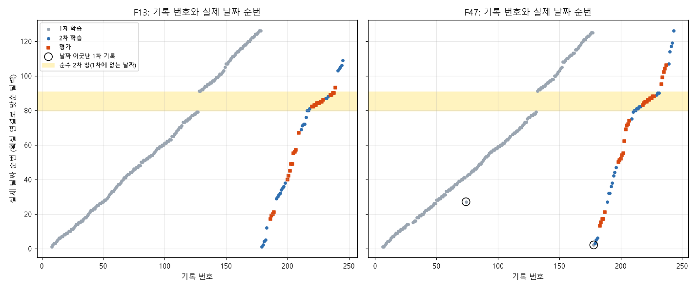

# F13·F47 기록의 실제 날짜 정리 (v1)

2026-10-12 집 클로드. 재현 스크립트는 `dm2`·`dm7`~`dm12`(이 폴더)이고, 기록별 날짜표는 `dm11_calendar_v1.csv`, 그림은 `dm11_calendar_v1.png`입니다.
이 문서는 구조를 서술한 것입니다. 예측 특징으로 쓰려면 규정(평가 행은 같은 온실의 현재·이전 입력만 사용)을 따로 점검해야 합니다.

## 한 줄 요약

기록 번호는 날짜와 대체로 같은 방향으로 가지만, 실제로는 **두 번에 걸쳐 시즌을 훑은 자료**입니다.

- **1차(번호 ~178)**: 하루에 F13·F47 각 1~2동씩 거의 매일 이어집니다.
- **2차(번호 179~)**: 같은 시즌을 처음부터 다시 띄엄띄엄 훑습니다.
- **1차에 빠진 11일**이 하나 있고, 그 기간은 2차 기록만으로 채워져 있습니다(아래 "순수 2차 창"). 평가 기록이 가장 많이 몰린 곳이 여기입니다.

## 어떻게 맞췄나

1. **날짜 묶음 만들기.** 외기 4변수의 24시간 값이 90% 이상 똑같은 기록끼리 같은 날짜로 묶었습니다. 460개 기록이 129개 묶음이 됩니다. 묶음 크기는 4개짜리 81, 3개짜리 43, 2개 이하 5입니다.
2. **1차 순서 정하기.** 1차 F13 번호 순서로 묶음을 늘어놓았습니다.
3. **다음날 검산.** 학습 정답의 "확실 연결"(같은 동의 23시 → 다음날 0시에서 EC와 배지 온도가 이어지는 쌍)로 묶음 사이 다음날 관계를 확인했습니다.
   - 1차에 없는 날짜는 이 연결이 가리키는 자리에 끼워 넣었습니다.
   - 외기의 자정 연속성만으로는 다음날을 고를 수 없었습니다. 서로 무관한 날끼리도 연속성 값이 0.1~0.4로 흔히 나오기 때문입니다.
4. **결과.** 126일을 배치했고, 확실 연결 186개 중 184개가 정확히 +1일이 됐습니다. 나머지 2개는 +2일인데, 사이에 위치가 확정되지 않은 날짜가 하나씩 있습니다.

## 1. 2차는 시즌을 처음부터 다시 훑는다

| 2차 번호 | 실제 날짜(순번) | 비고 |
|---|---|---|
| F13 179~215, F47 179~210 | 1일 → 79일 | 1차와 같은 날짜. 같은 날 1차 기록이 있음 |
| F13 216~238, F47 211~231 | **80일 → 90일** | **순수 2차 창**: 1차에 없는 날짜 |
| F13 239~245, F47 233~243 | 91일 → 126일 | 다시 1차와 같은 날짜 |

- 2차 번호를 따라가면 날짜가 뒤로 돌아가는 곳이 0개입니다. 2차 번호는 날짜 순서 그대로입니다.
- 2차 학습·평가 116기록 가운데 74개가 1차 기록과 날짜가 같습니다. 평가 60개만 보면 34개입니다.

## 2. 1차에도 날짜가 비는 곳이 있다

1차 번호가 하나 늘었는데 날짜는 이틀 이상 건너뛰는 곳입니다.

| 1차 번호 | 날짜 간격 | 사이에 들어간 날짜 |
|---|---|---|
| **F13 127 → 128, F47 131 → 132** | **12일** | 순수 2차 창 11일(80~90일) |
| F13 80 → 81 | 2일 | 49일: F13_203\*·204\*(평가), F47_085·086 |
| F13 114 → 115 | 2일 | 72일: F13_213·214, F47_121, F47_206\* |
| F13 148 → 149 → 150 | 2일씩 | 104일: F13_242, F47_151, F47_236\*. 106일: F13_244, F47_237\* |
| F13 105 → 106 | 2일 | 확실 연결 F13_104 → F13_106이 +2. 사이 날짜는 F13_208\* 또는 F47_111로 추정(미확정) |

\* 표시는 평가 기록입니다.

- "번호 = 상대 일차"라는 전제는 **1차 안에서도 이 다섯 곳에서 깨집니다**. 특히 127→128 사이에는 11일이 빠져 있습니다.
- 지금 쓰는 계절 지표(계절표)는 1차 번호를 날짜로 씁니다. 그래서 F13 128번 이후 1차 기록의 계절 값은 실제 날짜보다 **약 11~14일 앞선 값**으로 매겨져 있는 셈입니다. 이게 예측에 얼마나 영향을 주는지는 아직 시험하지 않았습니다.

## 3. F47은 F13보다 날짜가 늦게 간다

- 1차 F47 번호는 같은 날짜의 F13 번호보다 작습니다. 구간별로 −1일에서 −5.5일까지 차이가 납니다(6.636).
- F47 1~30번 구간은 확실 연결 F47_029 → F47_006처럼 순서가 거꾸로 된 곳도 있습니다. F47_028~030과 F13_185\* 묶음은 위치를 확정하지 못했습니다.

## 4. 날짜가 어긋난 1차 기록 2개

| 기록 | 번호가 말하는 날짜 | 실제 날짜 | 내용 |
|---|---|---|---|
| **F47_178** | 1차 끝(시즌 말) | **2일째** | 외기·EC 0.33·배지·낮 실내가 2일째 형제 기록과 같음. 다음 기록 F47_179(3일째)로 EC·배지 온도가 그대로 이어짐 → 사실상 **2차의 첫 기록**. 다만 0~4시 실내 온도·습도(10.6/9.6℃, 76%)만 바로 앞 F47_177(시즌 말, 영하)의 23시 값에서 이어짐 → 1·2차를 이어 붙인 경계에서 **앞 기록의 새벽이 섞인 흔적** |
| **F47_074** | 약 75일째 | **27일째** | 외기가 F13_049 날짜와 같음. 실내·배지 온도는 번호 이웃보다 3~4℃ 높고, 이웃이 난방을 쓰는 동안 이 기록은 난방 0 |

- 두 기록 모두 계절 값이 번호 기준으로 잘못 붙어 있습니다.
- 이 두 기록을 학습에서 빼는 시험(OL1)의 효과는 잡음 수준이었습니다(6.664).

## 5. 평가 기록은 어디에 있나 (60개)

| 날짜 종류 | 평가 기록 수 | 의미 |
|---|---|---|
| 1차와 같은 날짜 | 29 | 같은 날 정답 있는 1차 기록이 있음. 전날 날짜도 대부분 1차로 확정 가능 |
| **순수 2차 창(80~90일)** | **24** | 같은 날 학습 기록이 적음. 11일 동안 학습 기록은 15개뿐(F13_216·217·218·231·232·233, F47_211~216·229·230·231) |
| 1차 사이에 끼어든 날짜 | 5 | F13_203·204, F47_206, F47_236, F47_237 |
| 위치 미확정 | 2 | F13_185, F13_208 |

- 앞서 판정이 안 됐던 **F47_221·F13_228은 모두 순수 2차 창(85일째)**에 있습니다. 대상 날짜에 학습 기록이 하나도 없어서 전날 날짜를 확정하지 못했던 이유가 이것입니다.
- 반대로 **F47_233은 1차 날짜(1차 F13_135 등과 같은 날)**에 있어서, 전날과 형제 기록이 모두 학습 기록이었고 소거로 풀렸습니다(6.663).
- 결국 **평가 24개가 몰린 11일짜리 순수 2차 창이 가장 큰 정보 구멍**입니다.
  - 창 안 확실 연결은 F13_216 → 218 → 220 하나뿐입니다(시작이 79일째 F13_126·F47_131에서 이어짐).
  - 나머지 날들은 평가 기록끼리만 이어집니다.

## 6. 섞인 것처럼 보였지만 아닌 것

- **F47_148 → F13_147.** 같은 날짜 형제와 실내가 하루 종일 크게 다릅니다. 그러나 둘이 서로 이어지는 **같은 동의 연속된 이틀**입니다(CO₂ 2024→2024, 배지 9.6→9.7℃, EC 0.41). 동이 온실 ID를 넘나드는 현상(6.577)의 한 예이고, 유난히 추운 동(실내 8~11℃, 밤 CO₂ 2,000ppm)일 뿐입니다.

## 남은 확인거리

1. 계절 값 바로잡기 효과: F13 128번 이후 1차가 약 12일 밀린 것과 F47_178·F47_074의 계절 값을 실제 날짜로 고쳤을 때 효과. SF1(6.636, F47을 F13 달력으로 옮기기)은 2차에서 실패했으므로 신중해야 합니다.
2. 순수 2차 창(80~90일)의 하루 순서: 2차 번호 순서를 날짜 순서로 가정했습니다. 앞쪽 3일만 확실 연결로 검증됐습니다.
3. 위치 미확정 3묶음: F13_185\*·F47_028~030, F13_208\*, F47_111.
